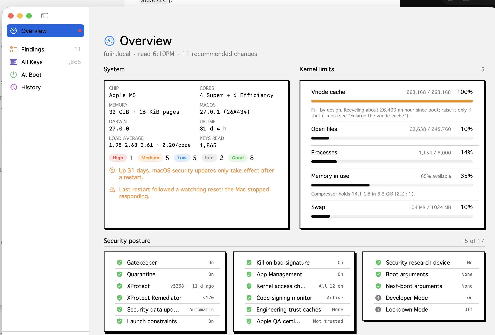

# Fuxi

Fuxi is a native macOS app that reviews the kernel's `sysctl` settings for security and performance. It explains each finding in plain language and turns the changes you pick into a short shell script that you read and run with `sudo`. Fuxi itself never runs anything as root. It records every change so you can revert it, and can export a script that keeps your changes across restarts with `/etc/sysctl.conf`.

It is written for a developer Mac on Apple silicon: one that runs containers, VMs, VPN tunnels and local language models. The recommendations assume that. Read each finding's explanation before applying it to a different kind of machine.




- [Requirements](#requirements)
- [Build and install](#build-and-install)
- [The five screens](#the-five-screens)
- [What Fuxi checks](#what-fuxi-checks)
- [How changes are applied](#how-changes-are-applied)
- [Keeping changes at boot](#keeping-changes-at-boot)
- [Files Fuxi reads and writes](#files-fuxi-reads-and-writes)
- [Security model](#security-model)
- [Caveats](#caveats)
- [Project layout](#project-layout)
- [Adding a check](#adding-a-check)
- [Remove everything](#remove-everything)
- [License](#license)

## Requirements

- macOS 14 Sonoma or later
- Xcode command-line tools (`xcode-select --install`), or full Xcode
- An administrator account to run the exported scripts with `sudo`. Reviewing needs no special rights.

## Build and install

```sh
git clone https://github.com/rgregory/Fuxi.git
cd Fuxi
./build-app.sh
open build/Fuxi.app
```

`build-app.sh` runs `swift build -c release`, assembles `build/Fuxi.app` with the icon and `Info.plist` from `Support/`, and signs it ad hoc so it runs on the Mac that built it. To keep it:

```sh
cp -R build/Fuxi.app /Applications/
```

You can also open `Package.swift` in Xcode and press Run.

The build is not notarized. Another Mac will block a copy of it until you right-click › Open, or build it there.

## The five screens

Fuxi reads every key from `sysctl -a` when it opens. **Reload** (⌘R) reads them again.

### Overview

- **Machine facts:** model, chip, core layout (for example 4 Performance + 6 Efficiency), memory and page size, macOS and Darwin versions, uptime, load average with load per core, memory pressure, and how many keys were read.
- **Limits:** how close the kernel is to its ceilings for the vnode cache, open files, processes, memory and swap. A full vnode cache is normal after long uptime, so that gauge shows how many entries are recycled per hour instead. The memory gauge shows the compressor's ratio, for example 18.9 GiB held in 8.6 GiB (2.2 : 1).
- **Last restart:** a warning when the previous boot ended in a kernel panic or a watchdog reset (the Mac stopped responding), read from `kern.shutdownreason`.
- **Security posture:** read-only state that `sysctl` reports but can't change. It covers Gatekeeper, quarantine, XProtect (signature version and age, Remediator, automatic security updates), launch constraints, kill on bad signature, App Management, mandatory access checks on every kernel object type, the code-signing monitor, engineering trust caches, Apple QA certificates, security-research hardware, current and next-boot boot arguments, Developer Mode and Lockdown Mode. Each item has a one-line explanation.

### Findings

Each check shows the key, its current value, the value Fuxi recommends, a severity and why it matters. Checks that could break something you use carry a caution and start unselected.

Select several and choose **Apply Selected…** to export them as one script, or use **Apply…** on a single finding. The sidebar badge counts findings that still need action.

### All Keys

Every key from `sysctl -a`, searchable by key or value and filterable by namespace. **Reviewed only** narrows the list to the keys Fuxi checks. Double-click a row, or right-click › **Set Value…**, to change any writable key. The kernel rejects keys that are read-only or values out of range; the script prints which.

### At Boot

Every value Fuxi has changed from its macOS default, with the `sysctl.conf` Fuxi would write. **Install at Boot…** exports a script that writes them, **Update…** exports one that rewrites the file after further changes, and **Remove…** exports one that takes them out. A green check means the installed file matches; orange means you've changed settings since installing. See [Keeping changes at boot](#keeping-changes-at-boot).

Each row can **Restore Default…** (write the macOS value back) or **Stop Keeping** (leave the current value but drop it from the boot file).

### History

Every change with the time, the old value and the new value, and a **Revert…** button. **Clear History** empties the list without changing any settings.

### Themes

**View › Theme** has Retro (the default), Tron and Classic. **⇧⌘T** flips between Retro and Tron.

**View › Theme › Classic** switches to a plain macOS list layout with system controls. ⇧⌘T returns to Retro from Classic or Tron.

| Theme | Look |
|---|---|
| Retro | Off-white window, white panels with 2-px black borders and hard black drop shadows, slightly rounded buttons, square checkboxes, black segment strips, monochrome, system font |
| Tron | Black grid, glowing cyan chamfered panels, uppercase glowing headings, cyan outlined controls, Orbitron (or a condensed sans) |

Severity colours stay the same in both.


To build a copy that opens in Tron by default:

```sh
./build-app.sh tron
open build/"Fuxi Tron.app"
```

## What Fuxi checks

Severity is the level shown when the current value doesn't match: **High**, **Medium**, **Low** or **Info**. A matching value shows as **Good**.

### Security

| Check | Key | Recommended | Severity | Selected by default |
|---|---|---|---|---|
| Stop accepting IPv6 redirects | `net.inet6.icmp6.rediraccept` | `0` | High | Yes |
| Drop IPv4 redirects | `net.inet.icmp.drop_redirect` | `1` | High | Yes |
| Refuse source-routed packets | `net.inet.ip.accept_sourceroute` | `0` | Medium | Yes |
| Don't send IPv4 redirects | `net.inet.ip.redirect` | `0` | Medium | Yes |
| Don't send IPv6 redirects | `net.inet6.ip6.redirect` | `0` | Medium | Yes |
| Turn off IPv4 forwarding | `net.inet.ip.forwarding` | `0` | Medium | No — containers, VMs and Internet Sharing need it |
| Turn off IPv6 forwarding | `net.inet6.ip6.forwarding` | `0` | Medium | No — same reason |
| Ignore broadcast and multicast pings | `net.inet.icmp.bmcastecho` | `0` | Low | Yes |
| Stay silent on closed TCP ports | `net.inet.tcp.blackhole` | `2` | Low | Yes |
| Stay silent on closed UDP ports | `net.inet.udp.blackhole` | `1` | Low | Yes |
| Drop SYN+FIN packets | `net.inet.tcp.drop_synfin` | `1` | Low | Yes |
| Turn off core dumps | `kern.coredump` | `0` | Low | No — needed to debug native crashes |

Why the first one is High: any host on the same Wi-Fi can send an ICMPv6 redirect and route your traffic through itself. macOS already drops IPv4 redirects, so IPv6 is the gap.

### Performance

| Check | Key | Recommended | Severity | Selected by default |
|---|---|---|---|---|
| Enlarge the vnode cache | `kern.maxvnodes` | at least `524288` | Medium | Yes |
| Raise the listen backlog | `kern.ipc.somaxconn` | at least `1024` | Low | Yes |
| Raise the default TCP MSS | `net.inet.tcp.mssdflt` | at least `1440` | Low | No — small gain |
| Let the GPU wire more memory | `iogpu.wired_limit_mb` | 75% of RAM, in MB | Low | No — only for models over about 20 GB |

Notes:

- **Vnode cache.** macOS fills this cache and then recycles entries, so being at the maximum is normal. Raising it helps only when your working set doesn't fit: large repositories, `node_modules`, container image layers. Try it for one boot; if it fills again within a day, keep it. Doubling costs a few hundred MB of kernel memory.
- **Listen backlog.** This is a ceiling. A server still has to ask for a larger backlog when it calls `listen()`, and servers already running keep their old queue until they restart.
- **GPU memory.** At `0`, macOS lets the GPU wire roughly two-thirds to three-quarters of RAM. Leave at least 8 GB for macOS.

### Advisories

These report a state but never write anything:

| Advisory | Key | Good when |
|---|---|---|
| Developer Mode | `security.mac.amfi.developer_mode_status` | `0` (on is expected on a development Mac; change it in System Settings › Privacy & Security) |
| Hibernation image | `kern.hibernatemode` | `0` (modes 3 and 25 write a memory image to `/var/vm/sleepimage`; change with `pmset`) |
| TCP reassembly overflows | `net.inet.tcp.reass.overflows` | under 100,000 (a high count points to a lossy link, such as Wi-Fi or a VPN, not a kernel limit) |
| TCP receive buffer | `net.inet.tcp.recvspace` | 128 KB or more |
| System V shared memory | `kern.sysv.shmmax` | always informational; matters only for older software |

## How changes are applied

Fuxi never asks for your password and never runs anything as root. Every change goes through a script you can read before you run it.

1. Fuxi checks every key and value against a narrow character set: letters, digits and `. _ - :` (plus `,` in values), at most 128 characters, never starting with `-`. Anything else is refused before it goes into a script.
2. It asks where to save the script (Downloads by default) and writes it there.
3. It copies the command to run to the clipboard, for example `sudo sh ~/Downloads/fuxi-apply.sh`.
4. You read the script and run it in Terminal. It refuses to run without `sudo`, and prints each change and any key the kernel rejects.
5. When you switch back to Fuxi it reads the kernel again and records what actually changed in History. Values that differ from the macOS default join the boot list; a value set back to its default leaves it.

An apply script looks like this:

```sh
#!/bin/sh
# Generated by Fuxi on 2026-11-02T22:30:00Z for my-mac.local.
# Changes 2 kernel setting(s). They last until the next restart.
# Read it first, then run:  sudo sh fuxi-apply.sh

if [ "$(id -u)" -ne 0 ]; then
  echo "Run this with sudo: sudo sh \"$0\"" >&2
  exit 1
fi

status=0

# kern.ipc.somaxconn: 128 -> 1024
/usr/sbin/sysctl -w kern.ipc.somaxconn=1024 || { echo "Rejected: kern.ipc.somaxconn" >&2; status=1; }

# net.inet6.icmp6.rediraccept: 1 -> 0
/usr/sbin/sysctl -w net.inet6.icmp6.rediraccept=0 || { echo "Rejected: net.inet6.icmp6.rediraccept" >&2; status=1; }

exit $status
```

Changes made with `sysctl -w` take effect immediately and last until the next restart. A saved script can be run again later, or on another Mac.

On first launch Fuxi saves every current value as the macOS default. That snapshot is what **Restore Default…** writes back. If you had already changed settings before the first launch, those values become the "defaults"; delete the state file (see [below](#files-fuxi-reads-and-writes)) after a clean restart to take a new snapshot.

## Keeping changes at boot

**Install at Boot…** exports `fuxi-boot-install.sh`. Run with `sudo`, it writes the boot list to `/etc/sysctl.conf`, which macOS reads at startup:

```
# Managed by Fuxi. Changes made here are overwritten.

kern.ipc.somaxconn=1024
kern.maxvnodes=524288
net.inet6.icmp6.rediraccept=0
```

- **An existing file is backed up first.** If `/etc/sysctl.conf` exists and Fuxi didn't write it, the script copies it once to `/etc/sysctl.conf.fuxi-backup`. Later updates don't touch the backup.
- **Fuxi owns the whole file.** Lines you add by hand are overwritten on the next update. Set extra keys through Fuxi instead, from All Keys.
- **Remove…** exports `fuxi-boot-remove.sh`, which puts the backup back, or deletes Fuxi's file if there was no backup. It refuses to touch a `sysctl.conf` that Fuxi didn't write.
- **Restart, then check At Boot.** macOS applies `sysctl.conf` early in startup, but some services set their own keys afterwards. The forwarding keys are the common case: vmnet turns forwarding back on whenever a container or VM network starts. A key that shows its old value after a restart is owned by such a service, and no boot file will hold it.

## Files Fuxi reads and writes

| Path | Access | Purpose |
|---|---|---|
| `/usr/sbin/sysctl -a` | read | Every kernel setting |
| Kernel process table (`KERN_PROC_ALL`) | read | Number of running processes |
| `nvram boot-args` | read | Boot arguments queued for the next restart |
| `/private/var/protected/xprotect/XProtect.bundle`, `/Library/Apple/System/Library/CoreServices/XProtect.bundle` | read | XProtect signature version and date |
| `/Library/Apple/System/Library/CoreServices/XProtect.app` | read | XProtect Remediator version |
| `/Library/Preferences/com.apple.SoftwareUpdate.plist` | read | Whether security updates install automatically |
| `~/Library/Application Support/Fuxi/state.json` | read/write | Default snapshot, change history and boot list |
| `/etc/sysctl.conf` | read | Whether the boot file is installed and current |
| Scripts you save (`fuxi-apply.sh`, `fuxi-boot-install.sh`, `fuxi-boot-remove.sh`) | write | Changes for you to run with `sudo` |

Fuxi writes nothing as root. Only the scripts you run touch `/etc/sysctl.conf` and `/etc/sysctl.conf.fuxi-backup`.

Fuxi makes no network connections.

## Security model

- **No root, ever.** Fuxi runs as you. It has no privileged helper, launch daemon, login item or background process, and never shows a password prompt.
- **You run every change.** Each change is a plain shell script saved where you choose. Read it, keep it, run it with `sudo`, or don't. Nothing changes until you do.
- **Input restricted before it goes into a script.** Keys and values are checked against the character set above, so a crafted value can't add shell syntax. Current values copied into comments are kept to one line.
- **Scripts check for root.** Each one exits with a message unless it's run with `sudo`, and the boot-remove script won't touch a `sysctl.conf` that Fuxi didn't write.
- **Read-only security checks.** Gatekeeper, XProtect, code signing, boot arguments and the other posture items are reported only.
- **Ad hoc signing.** `build-app.sh` signs the app for the Mac that built it. It isn't notarized or distributed.

## Caveats

- **Defaults depend on the first launch.** See [How changes are applied](#how-changes-are-applied).
- **Keys change between macOS releases.** Keys appear, disappear and change meaning. A check whose key is missing shows as Info with no value. Review findings after each major upgrade.
- **Some keys are read-only.** The kernel rejects writes to them, and Fuxi reports the rejection.
- **Forwarding is managed by macOS.** Turning it off breaks container, VM and Internet Sharing networking until something turns it on again, which vmnet does on its own.
- **Kernel settings can affect stability.** Fuxi limits itself to `sysctl` and never touches SIP, Gatekeeper, code signing or boot security. If a change causes trouble, use **Revert…** in History to export a script that puts the old value back, or restart: changes not saved at boot are gone after a restart.

## Project layout

```
Package.swift            Swift package, macOS 14+, one executable target
build-app.sh             Release build, .app bundle and ad hoc signature
Support/                 Info.plist and app icon
Sources/Fuxi/
  FuxiApp.swift          App entry, menu commands, sidebar and shared views
  AppModel.swift         State: snapshot, findings, posture, gauges, exports, history
  Rules.swift            The check catalog and how findings are evaluated
  Sysctl.swift           Reading and parsing sysctl -a, input validation
  ScriptExport.swift     The apply and boot scripts, save panel, clipboard command
  Persistence.swift      state.json and reading /etc/sysctl.conf
  XProtect.swift         XProtect and Software Update state
  Themes/                Theme protocol, Retro and Tron, themed controls
  Things.swift           Sidebar and the five pages
  Shared.swift           Finding rows, Set Value sheet, boot rows
  Views.swift            Classic layout
```

## Adding a check

Checks live in `Catalog.rules` in `Sources/Fuxi/Rules.swift`. Three helpers cover most cases:

```swift
// Exact value
fix("drop-synfin", .security, "net.inet.tcp.drop_synfin", to: "1", .low,
    "Drop SYN+FIN packets",
    "Packets with both flags set are only used for OS fingerprinting.")

// Minimum value
atLeast("somaxconn", .performance, "kern.ipc.somaxconn", 1024, .low,
        "Raise the listen backlog",
        "Local servers drop connections when bursts exceed the pending-accept queue.")

// Report only, never written
advisory("hibernate", .security, "kern.hibernatemode",
         "Hibernation image",
         "Mode 0 writes no memory image to disk at sleep.",
         compliant: { cur, _ in cur == "0" })
```

Pass `selected: false` and a `caution:` for any change that can break something people use. For a target that depends on the machine, build a `Rule` directly; the GPU check, which computes 75% of `hw.memsize`, is an example.

## Remove everything

Use **At Boot › Remove…** and run its script first if you installed at boot. Or by hand:

```sh
sudo rm -f /etc/sysctl.conf
[ -f /etc/sysctl.conf.fuxi-backup ] && sudo mv /etc/sysctl.conf.fuxi-backup /etc/sysctl.conf
rm -rf ~/Library/Application\ Support/Fuxi
rm -rf /Applications/Fuxi.app
```

Settings changed with `sysctl -w` return to their macOS defaults at the next restart.

## License

Copyright 2026 Roger Gregory <rtgregory@gmail.com>

Licensed under the Apache License, Version 2.0 (the "License"); you may not use this project except in compliance with the License. You may obtain a copy of the License in [LICENSE](LICENSE) or at

    http://www.apache.org/licenses/LICENSE-2.0

Unless required by applicable law or agreed to in writing, software distributed under the License is distributed on an "AS IS" BASIS, WITHOUT WARRANTIES OR CONDITIONS OF ANY KIND, either express or implied. See the License for the specific language governing permissions and limitations under the License.
